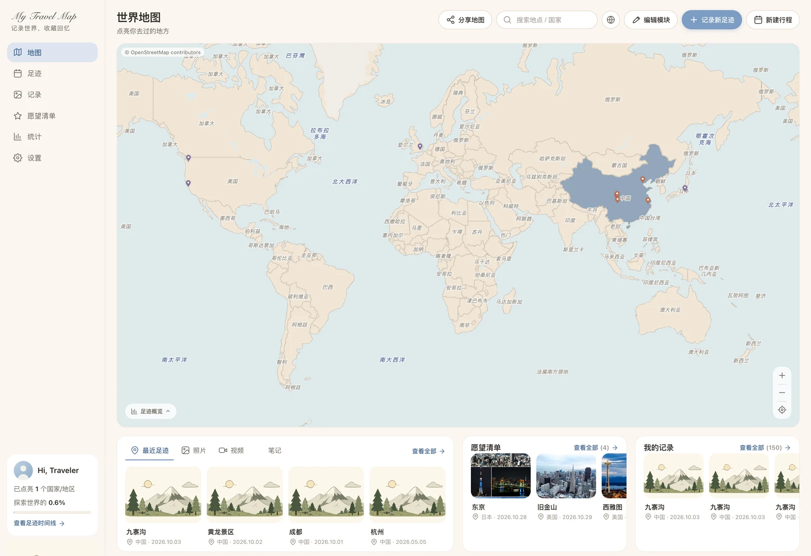

# TravelMap

自托管的旅行足迹地图。把静态的「去过哪些地方」升级成一份可长期维护的个人旅行档案：地图打点、国家上色、照片 / 视频 / 文字笔记、按拍摄日排布的行程时间轴，全部数据落在自己的机器上，一个 Docker 镜像即可运行。


<p align="center">
  
</p>

<p align="center"><sub>首页：世界地图总览与国家上色，下方为最近足迹 / 愿望清单 / 我的记录等小组件</sub></p>

## 功能

- **足迹地图**：MapLibre GL JS + OpenFreeMap 矢量瓦片（无需 API Key），到访国家自动上色，支持点位聚合、图例与路线回放。
- **地点详情**：全屏双栏布局。左栏为地图与故事卡（封面、三栏指标、备注），右栏按**照片拍摄日**分组的竖向时间轴；全屏时地图上以 1 km 去重绘制照片点位。
- **新增足迹**：名称、类型、日期、经纬度（支持在地图上拾取），可同时上传照片、视频或仅写文字笔记；照片自动读取 EXIF 拍摄时间与 GPS。
- **媒体处理**：图片压成 1600 px 原图 + 720 px webp 缩略图；iPhone 的 HEVC/H.265 视频转码为 H.264 并抽首帧作封面，保证各端可播。
- **首页小组件**：iOS 风格磁贴桌面，内置最近足迹、愿望清单、合集、海报墙、待整理照片、上次行程、随机回顾、月度统计共 8 个组件，支持拖拽排序、尺寸切换与布局重置。
- **愿望清单**：想去的地方可加优先级、备注与目标时间，与真实足迹分开管理；既可从既有地点标记，也可自建尚无坐标的地点。
- **数据自主**：SQLite 单文件数据库 + MinIO / 本地目录媒体存储，支持一键导出 / 导入 zip 包，迁移与备份都是拷贝文件夹。
- **单密码鉴权**：HMAC 签名的 httpOnly 会话 Cookie，无账号体系，适合个人或家庭小范围使用。

## 技术栈

| 层 | 技术 | 说明 |
|----|------|------|
| 后端运行时 | Node.js 20 + Express 4 | 单进程 HTTP 服务，同时托管前端静态文件与 REST API |
| 数据库 | better-sqlite3（SQLite） | 地点 / 行程 / 媒体元数据存 `/data/travelmap.db`，零外部依赖、单文件可备份 |
| 媒体对象存储 | MinIO（S3 兼容） | 照片 / 视频 / 缩略图存对象存储；默认由 compose 起一个内置 minio 服务，也可指向自建 MinIO、阿里云 OSS 或任意 S3 |
| 图片处理 | sharp | 1600 px 原图 + 720 px 缩略图（webp） |
| 视频转码 | ffmpeg | HEVC / H.265 → H.264，并抽取首帧海报 |
| 上传中间件 | multer | 先落临时目录再转码上传，限制单文件大小 |
| 前端 | 原生 HTML / CSS / ESM（零构建） | MapLibre GL JS + OpenFreeMap 矢量瓦片；渲染层（地图 / 海报墙 / 统计）直接消费与 `places.json` 同构的数据 |
| 鉴权 | 单密码 + HMAC 会话 Cookie | 由 `ADMIN_PASSWORD` 设置密码；留空即开放访问，仅建议本地调试使用 |
| 部署 | Docker + Docker Compose | 两阶段镜像（构建期编译原生模块，运行期仅保留 ffmpeg），`travelmap` + `minio` 两个服务 |

## 目录结构

```
travelmap/
├── server.js                # Express 入口：静态托管 + REST API + 上传转码 + 首屏配置向导
├── src/
│   ├── db.js                # SQLite 数据层；导出与 places.json 同构的数据；库为空时自动 seed
│   ├── auth.js              # 单密码登录 / 会话校验（HMAC 签名 httpOnly cookie）
│   └── storage.js           # 媒体存储抽象：MinIO（默认）/ 本地目录；可变配置 + 连通性测试
├── web/                     # 前端（原生 HTML/CSS/ESM，零构建，由 Express 直接托管）
│   ├── index.html           # 页面骨架：登录遮罩、首屏配置向导 #tm-setup、记录新足迹弹窗
│   ├── css/                 # tokens / base / layout / components / widget / modal / poster / app
│   └── js/
│       ├── main.js          # 启动编排：初始化鉴权 → 首屏向导 → 渲染主界面
│       ├── api.js           # 后端接口封装
│       ├── auth.js          # 登录态管理
│       ├── setup.js         # 首屏配置向导（拉取预填值、提交保存）
│       ├── upload.js        # 新增地点与媒体上传
│       ├── upload-modal.js  # 上传进度与结果提示
│       ├── trip-edit.js     # 行程编辑
│       ├── detail-modal.js  # 地点详情（全屏双栏 + 拍摄日时间轴）
│       ├── ui.js            # 主界面与小组件编排
│       ├── wishstore.js     # 愿望清单数据源（服务端 + 本地镜像）
│       ├── archive.js       # 导出 / 导入 zip
│       ├── map.js / markers.js / countries.js / geo.js / legend.js / route.js
│       ├── cities.js / country-centroids.js   # 城市与国家补全
│       ├── poster.js / stats.js / data.js / config.js / utils.js
├── data/                    # 运行时数据目录（绑定挂载到宿主机）
│   ├── seed/places.json     # 初始种子（38 个示例地点）；首次启动自动导入
│   ├── travelmap.db*        # 运行时生成的 SQLite 库（已 gitignore）
│   └── media/               # 本地目录模式下上传的媒体（已 gitignore）
├── Dockerfile               # 两阶段构建：build 装依赖并编译原生模块 → runtime 仅留 ffmpeg
├── docker-compose.yml       # 唯一编排文件：开发 --build 构建、部署 pull 拉镜像共用
├── docker-compose.tunnel.yml # 可选 overlay：额外起 cloudflared 边车，把 8080 通过 CF 隧道暴露公网
├── publish.sh               # 唯一发布脚本：构建并推送多架构镜像（--proxy 切 Mac 代理路线）
├── docs/PUBLISHING.md       # 运维手册：发布镜像的两条路线、验证、清理、报错速查、代理分工
├── docs/screenshots/        # README 使用的界面截图（webp，随仓库分发）
├── preview/                 # 本地验收产物（Playwright 脚本 + 截图），已 gitignore，不参与构建
├── .dockerignore            # 忽略 node_modules / *.db / data/media / minio-data（seed 仍打进镜像）
├── .env.example             # 配置模板：APP_PORT / DH_USER / ADMIN_PASSWORD / MINIO_* / 数据目录
└── .gitignore
```

> [!NOTE]
> `data/` 与 `minio-data/` 是运行时产生的持久数据，既不进镜像也不进 git。服务启动后它们会出现在项目根目录，可直接通过文件管理器查看与备份。

## 快速开始

### 环境要求

- **Docker + Docker Compose**
  - macOS：安装 [Docker Desktop](https://www.docker.com/products/docker-desktop/) 并启动。
  - Linux 小主机：`curl -fsSL https://get.docker.com | sh`，随后 `sudo usermod -aG docker $USER`。
- 首次构建需联网拉取依赖并编译原生模块（better-sqlite3 / sharp）。Dockerfile 内已预配多镜像兜底：apt 在 ustc / tuna / 163 / 华为云 / 阿里云 / 腾讯云之间轮转，任一可达即可用，单个镜像站偶发 502 会自动切换；npm 走 npmmirror，正常耗时数分钟。**国内网络环境下不建议把镜像源改回官方源。**

### 本地启动

```bash
# 1) 进入项目目录
cd travelmap

# 2) 建立 .env（可选但推荐），设置访问密码
cp .env.example .env
#    ADMIN_PASSWORD 改为自定义强密码
#    SESSION_SECRET 建议填 `openssl rand -hex 32` 的输出，容器重启后已登录会话才不失效

# 3) 构建并启动（首次需编译，稍慢）
docker compose up -d --build

# 4) 确认服务就绪
docker compose logs -f travelmap
```

浏览器访问 **http://localhost:8080**，用 `.env` 中设置的密码登录。首次启动会自动导入 38 个示例地点，此后以实际新增与上传的数据为准。

停止服务：`docker compose down`。数据位于 `./data` 与 `./minio-data`，容器删除不影响。

> [!IMPORTANT]
> **关于内置 MinIO 镜像**：MinIO 官方自 2025-10 起停止分发 Docker 镜像（社区版改为仅源码发布），Docker Hub / Quay 上的 `minio/minio` 已下线，`docker pull` 会返回 `not found`。因此 compose 中的 minio 服务改用 Chainguard 从官方源码持续重建的免费镜像 `cgr.dev/chainguard/minio:latest`：同一份 MinIO，S3 协议与数据格式完全兼容，默认以非 root 运行，既有 `./minio-data` 可直接挂载沿用，无需迁移。参见 [Chainguard 公告](https://www.chainguard.dev/unchained/secure-and-free-minio-chainguard-containers)。

### 首屏配置向导

首次进入（或 `setupDone` 标记被清除时）会弹出配置向导，用于选择媒体存放位置：

- **对象存储 MinIO（默认）**：表单已预填内置 MinIO 的连接信息——地址 `minio`、端口 `9000`、账号 `travelmap`、密码 `changeme-minio-password`、桶 `travelmap`，直接点「保存并进入」即可。
  - 也可在向导内改填自建 MinIO，或阿里云 OSS / 任意 S3（对应 endpoint / accessKey / secretKey / bucket）。
- **本地目录**：填写服务器上的绝对路径（如 `/data/media`），媒体直接写入磁盘。

> [!WARNING]
> 内置 MinIO 走 HTTP，`minio:9000` 没有 HTTPS，向导中的「启用 HTTPS」**不要勾选**。勾选后提交会报 `EPROTO wrong version number`（SSL 握手失败）。只有所指向的端点本身启用 HTTPS 时才需要勾选。

向导只决定「连哪个 MinIO / 用哪个桶 / 还是用本地目录」。MinIO 自身的磁盘落盘路径由 `docker-compose.yml` 中 minio 服务的卷决定，不在网页端配置。提交结果写入 `meta` 表，之后可直接在向导中修改，或清除 `setupDone` 标记重新配置。

### 数据落盘

默认两个目录都挂载在项目根目录，便于查看与备份：

| 目录 | 内容 | 对应 compose 卷 |
|------|------|----------------|
| `./data` | SQLite 库 `travelmap.db*` + 本地目录模式下的媒体 | `${APP_DATA_DIR:-./data}:/data` |
| `./minio-data` | MinIO 对象（含 `.minio.sys` 与 `travelmap` 桶） | `${MINIO_DATA_DIR:-./minio-data}:/data` |

更换路径（例如挂到大容量硬盘）：在 `.env` 中设置 `APP_DATA_DIR=/绝对/路径` 或 `MINIO_DATA_DIR=/绝对/路径`，再执行 `docker compose up -d`。

不使用内置 MinIO：删除 `docker-compose.yml` 中的 `minio` 服务，并把 `travelmap` 服务的 `MINIO_ENDPOINT` 改为自有 MinIO / S3 地址（向导内同样可以修改）。

## 日常运维

命令均在项目根目录执行：

| 操作 | 命令 |
|---|---|
| 首次构建并启动 | `docker compose up -d --build` |
| 修改代码后重启 | `docker compose up -d --build` |
| 仅重启、无代码变更 | `docker compose restart travelmap` |
| 停止、保留容器 | `docker compose stop` |
| 停止并删除容器 / 网络（数据保留） | `docker compose down` |
| 查看实时日志 | `docker compose logs -f travelmap` |
| 查看容器状态与端口 | `docker compose ps` |

`up -d --build` 是幂等的：只重建有变更的部分，其余命中缓存，无需先 `down` 再 `up`。所有 compose 命令都读取同目录的 `.env`；`.env` 缺失时 `down` / `logs` 仍可执行，但应用会以无鉴权模式运行，启动日志会打印 ⚠️ 警告。

- **新增足迹**：点顶部「记录新足迹」，填写名称 / 类型 / 日期 / 经纬度（可在地图上拾取坐标），选择照片、视频或撰写笔记后保存，地图与海报墙自动刷新。
- **视频**：HEVC 素材在服务端转码为 H.264，耗时数秒至数十秒，转码完成后才出现在海报墙。
- **编辑已有数据**：地点与行程的 `PUT / DELETE /api/places/:id`、`/api/trips/:id` 等接口已可用，前端目前以新增与上传为主，编辑界面按需补齐。

### 外部访问（无公网 IP）

- **Tailscale**（推荐，免费私网）：把小主机与手机 / 笔记本加入同一网络后，直接用分配的 `http://<机器名>:8080` 访问，全程加密，无需公网 IP、域名或端口映射。
- **Cloudflare Tunnel**（免费公网域名）：`cloudflared tunnel --url http://localhost:8080`，即可获得 `*.trycloudflare.com` 临时地址，也可绑定自有域名。仓库附带的 `docker-compose.tunnel.yml` 可把 cloudflared 作为边车一并启动。

### 备份与迁移

绑定挂载意味着备份就是拷贝文件夹：

```bash
docker compose down
cp -r ./data       /备份路径/data
cp -r ./minio-data /备份路径/minio-data
```

- **整体迁移到新机器**：把 `./data` 与 `./minio-data` 一并带走挂载即可，数据库与媒体互不丢失。
- **重置示例数据**：删除 `./data/travelmap.db*` 后重新启动，会从 `data/seed/places.json`（优先）或镜像内置种子重新导入 38 个地点；媒体桶用 `mc rb` / `mc mb` 重建。

## 配置项

| 变量 | 默认值 | 说明 |
|------|--------|------|
| `PORT` | `8080` | 服务监听端口（容器内） |
| `DATA_DIR` | `/data` | SQLite 数据库目录（容器内应挂卷） |
| `ADMIN_PASSWORD` | 空 | 空 = 开放访问（任何人可写）；生产环境务必设置强密码 |
| `SESSION_SECRET` | 随机 | 会话签名密钥；固定该值可使容器重启后会话不失效 |
| `MAX_UPLOAD_MB` | `500` | 单文件上传上限（MB） |
| `MINIO_ENDPOINT` | `minio` | MinIO / S3 主机名或 IP（compose 内即内置 minio 服务），向导可覆盖 |
| `MINIO_PORT` | `9000` | MinIO / S3 端口 |
| `MINIO_USE_SSL` | `false` | 是否以 HTTPS 访问 MinIO（内置 MinIO 为 false） |
| `MINIO_ACCESS_KEY` | `travelmap` | Access Key（对应 MinIO 的 `MINIO_ROOT_USER`） |
| `MINIO_SECRET_KEY` | `changeme-minio-password` | Secret Key（对应 MinIO 的 `MINIO_ROOT_PASSWORD`） |
| `MINIO_BUCKET` | `travelmap` | 桶名（不存在时自动创建） |
| `MINIO_DATA_DIR` | `./minio-data` | MinIO 磁盘落盘目录（宿主机路径，compose 卷使用） |
| `APP_DATA_DIR` | `./data` | 应用数据目录（宿主机路径，compose 卷使用） |

以上为**初始默认值**。向导提交后会写入 `meta` 表并在运行时套用，此后以向导保存的配置为准。

## 接口一览

除登录相关接口外均需有效会话，读写操作一视同仁。

| 方法与路径 | 用途 |
|---|---|
| `POST /api/login` `POST /api/logout` `GET /api/session` | 登录、登出、会话状态 |
| `GET /api/data` | 与 `places.json` 同构的全量数据（地点 / 行程 / 媒体 / 类型） |
| `POST /api/places` `PUT/DELETE /api/places/:id` | 地点增改删 |
| `POST /api/trips` `PUT/DELETE /api/trips/:id` | 行程增改删 |
| `POST /api/upload` | 媒体上传（图片压缩 / 视频转码） |
| `PUT/DELETE /api/media/:id` `GET /api/media/pending` | 媒体归属与未归类照片 |
| `GET/POST /api/setup` | 首屏配置向导读取与保存 |
| `GET /api/wishes`、`PUT /api/wishes/annotations/:placeId`、`POST/PUT/DELETE /api/wishes/places` | 愿望清单标注与自建地点 |
| `POST /api/gps/analyze` `POST /api/gps/apply` | 批量分析并回填照片 GPS |
| `GET /api/export-zip` `POST /api/import-zip` | 全量导出 / 导入 |
| `GET/PUT /api/profile` `POST /api/profile/avatar` | 个人信息与头像 |
| `GET /api/meta/:key` `POST /api/meta` | 元数据读写 |

## 从 Docker Hub 部署

适用于镜像已推送到 Docker Hub 的场景：在一台新机器（如 x86 小主机）上运行，**不需要源码**，只需 Docker + Compose。

### 前置

- 目标机器已安装 Docker 与 Docker Compose（要求同「[环境要求](#环境要求)」）。
- 无需 `docker login`，拉取的是公开镜像。

### 步骤

```bash
# 1) 将 docker-compose.yml 与 .env.example 复制到目标机器
#    （git clone 后只取这两个文件即可；带上源码也不影响，不会触发构建）

# 2) 建立 .env 并填写关键项
cp .env.example .env
#    DH_USER=wyc6036                        # Docker Hub 用户名，决定镜像路径 docker.io/<DH_USER>/travelmap
#    ADMIN_PASSWORD=<强密码>                 # 必填
#    SESSION_SECRET=$(openssl rand -hex 32)  # 建议固定，容器重启后会话不失效
#    APP_PORT=8080                          # 需要换端口时改这里（如 8081）
#    MINIO_DATA_DIR=./minio-data
#    APP_DATA_DIR=./data

# 3) 拉取并启动（部署机不要加 --build）
docker compose pull
docker compose up -d

# 4) 确认服务就绪
docker compose logs -f travelmap
```

> [!WARNING]
> 部署机不应使用 `--build`。`docker-compose.yml` 同时声明了 `image:` 与 `build:`（Compose 的标准「有则用、无则建」写法）：`up` 会先尝试 pull，pull 不到才回退构建。先执行 `pull` 即可确保拿到镜像、不触发本地构建；而部署机上没有 Dockerfile，一旦 pull 失败（断网、标签写错）而自动回退构建，就会报 `Dockerfile not found`。修复网络后重跑 `docker compose pull` 即可恢复。默认文件名会被自动识别，`-f docker-compose.yml` 可省略。

浏览器访问 **http://\<机器IP\>:8080**，使用 `.env` 中设置的密码登录。镜像已内置 GeoNames 城市库与 38 个种子地点，首次启动自动导入，数据从零开始累积。

**更新与回滚**：在新机器上重新执行 `pull && up -d` 即更新到最新镜像；回滚需保留旧版本标签。

### 镜像架构

镜像已发布为**多架构 OCI 索引（linux/amd64 + linux/arm64 合一）**，同一标签会自动匹配机器架构，ARM 设备无需额外配置：

| 标签 | 内含架构 | 适用机器 |
|------|----------|----------|
| `wyc6036/travelmap:latest` | amd64 + arm64 | x86 小主机、Apple Silicon Mac、树莓派等，可直接 `pull` |
| `wyc6036/travelmap:v3` | amd64 + arm64 | 同上，固定版本号，适合锁定版本部署 |

架构信息可用 `docker buildx imagetools inspect wyc6036/travelmap:latest` 核对，输出中应包含 `linux/amd64` 与 `linux/arm64` 两条。需要锁定版本时，保持 `.env` 中 `DH_USER` 不变，把 compose 里的 `image: ...:latest` 临时改为 `:v3`。

## 发布新版镜像（维护者）

将本地改动构建成镜像并推送至 Docker Hub，供上述部署机拉取。**完整运维手册见 [docs/PUBLISHING.md](docs/PUBLISHING.md)**（原理、一次性前置、验证、中间 tag 清理、报错速查表）。

```bash
docker login                       # 仅需一次
./publish.sh wyc6036 v4            # 路线 A：直连，一次产出 amd64 + arm64 多架构索引
./publish.sh wyc6036 v4 --proxy    # 路线 B：Mac 挂代理（默认端口 7890，可写 --proxy 7891）
```

- **路线 A（直连 buildx）**：`buildx --push` 一次构建两架构，适用于服务器或可直连 Docker Hub 的机器。
- **路线 B（守护进程 + 代理）**：由 `--proxy` 触发，分架构 `docker build` + `push`，再用 `imagetools create` 合成多架构索引。**macOS 上必须走这条**——`buildx` 的 docker-container builder 拿不到代理，会撞上 DNS 投毒并报 `i/o timeout`。
- Docker Desktop 代理如何填写、Clash 为何需开启 Allow LAN、`scutil --proxy` 自检方式 → [docs/PUBLISHING.md](docs/PUBLISHING.md) 第一、二节。
- `TLS connect ... EOF`、`is a manifest list`、`timeout awaiting response headers` 等报错对照 → 该文档第七节。
- 国内 `node:20-slim` 被镜像代理返回错架构时的 `NODE_BASE` 退化做法 → 该文档第七节末。

## 本地开发

```bash
npm install
ADMIN_PASSWORD=dev node server.js   # 访问 http://localhost:8080
```

> [!WARNING]
> 原生模块 better-sqlite3 / sharp 依赖本机编译工具链：macOS 需 Xcode Command Line Tools，Linux 需 build-essential。本地编译受阻时，优先改用上述 Docker 方式运行。

## 常见问题

- **构建卡在 apt / npm 超时**：Dockerfile 构建期已用多镜像兜底循环（ustc / tuna / 163 / 华为云 / 阿里云 / 腾讯云，任一可达即可用），npm 走 npmmirror，通常无需调整。若仍卡在 apt，多为容器内 DNS 无法解析这些镜像站（容器内 DNS 与宿主机不同，单站偶发 502）——可改用当前网络下其他可达的 Debian 镜像源，或临时把构建机 DNS 指向公共 DNS 后重建。npm 偏慢时可替换 `registry.npmmirror.com`。海外机器可直接恢复官方源（移除 Dockerfile 中的兜底循环，npm 改回 `registry.npmjs.org`）。
- **向导提交报 `EPROTO wrong version number`**：勾选了「启用 HTTPS」，但端点实际为 HTTP（内置 MinIO 即如此）。取消勾选后重新提交。
- **登录后地图 / 数据空白**：确认 `ADMIN_PASSWORD` 与登录密码一致；再用 `docker compose logs travelmap` 查看是否有 SQLite / MinIO 连接错误。
- **数据不见了**：检查 `./data/travelmap.db` 是否存在。容器重建不会影响绑定挂载的目录。

## 相关文档

| 文档 | 内容 |
|---|---|
| [docs/PUBLISHING.md](docs/PUBLISHING.md) | 镜像发布与运维：两条路线的原理、前置、验证、tag 清理、报错速查 |

本地验收脚本（Playwright 截图与检查）位于 `preview/`，该目录已被 gitignore，不随仓库分发。

## 许可证

本仓库目前为个人自托管项目，未附带开源许可证文件，默认保留所有权利。地图国界与地区标注遵循相关规范，数据展示仅用于个人足迹记录。若计划以开源方式分发，建议补充 `LICENSE`（如 MIT）并在此处更新说明。
